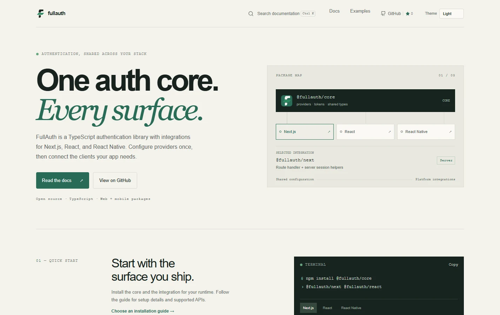

# Kaden — Full-Stack Developer Portfolio

[Open the live portfolio](https://a-allaaeddine.vercel.app/)

This repository contains the source for Kaden's personal portfolio and selected engineering case studies. The site presents open-source work, independent products, and client-facing projects; some client source repositories remain private.

## Technology

- Next.js 15 with the App Router
- React 18 and TypeScript
- Tailwind CSS, Radix UI, and Framer Motion
- `next-themes` for light, dark, and system appearance

## Main features

- Responsive portfolio homepage with profile, selected work, and contact sections.
- Project explorer with filters for all projects, client work, web, mobile, and library projects.
- Case-study pages at `/projects/[slug]`, with project context, contributions, technology, constraints, and approved gallery assets.
- Résumé download and email contact link. The contact action opens the visitor's email client; this site does not collect or store messages.
- Page metadata, sitemap, and robots route.

## Representative case-study visual

The portfolio already publishes this approved FullAuth project image in its case-study gallery:



## Repository structure

```text
app/                      App Router layout, homepage, sitemap, and project routes
components/               Portfolio sections, project explorer, navigation, and UI
lib/projects.ts           Case-study content and project metadata
lib/site.ts               Shared site origin and metadata helper
public/                   Public images and static assets
```

## Local development

Use Node.js and npm, then run:

```bash
npm ci
npm run dev
```

Open [http://localhost:3000](http://localhost:3000). To create and serve a production build locally:

```bash
npm run build
npm start
```

The repository's lint script is `npm run lint`.

## Build and deployment

The live site is hosted at [a-allaaeddine.vercel.app](https://a-allaaeddine.vercel.app/). The project is a standard Next.js application. The existing Vercel project manages preview and production deployments; its build command is `npm run build`. Preserve the existing project settings and production domain.

## Project boundaries

The portfolio documents selected contributions and known constraints. Source for private client projects is not included in this repository. FullAuth's case study and public documentation retain its unresolved security and platform limitations.
